## Mario Díaz González · Junior Frontend Developer

2nd-year Web Application Development (DAW) student from Logroño, Spain. I build modern, responsive and accessible interfaces with **React, TypeScript and Vue**, and I can connect them to a Node.js backend when needed.

- 💼 Frontend internship at **[Globant GUT](https://www.globant.com/es/gut-network)** (Vue, TypeScript, Tailwind CSS)
- 🏆 **[Bracketly](https://bracketly-mk.duckdns.org)**: esports tournament manager with an SVG bracket, animations and live results. 69 unit/API tests + 11 Playwright E2E, CI and auto-deploy
- 📊 **[LoLStats](https://lolstats-mk.duckdns.org)**: League of Legends stats dashboard with charts and per-match scoreboards, synced with the Riot API every 30 minutes
- 🎵 **[Kumafy](https://mk-1379.github.io/kumafy/)**: music player (Electron + web demo) with a Web Audio visualizer and 59 Vitest tests
- 🌐 **[Portfolio](https://mk-1379.github.io)**: built with Vue, TypeScript and Tailwind CSS, with an interactive 3D desk made in Three.js
- 📚 Currently learning: Next.js, Laravel and Angular

## 💻 Tech Stack

**Frontend**

       

**Backend**

     

**Testing & tools**

 ![Playwright](https://img.shields.io/badge/playwright-%232EAD33.svg?style=flat&logo=%3D)      

