## 💫 About Me

Hi, I'm Mario 👋

2nd-year Web Application Development (DAW) student from Logroño, Spain. I build full stack web apps with **React, TypeScript and Node.js**. I love the frontend side: turning designs into polished, accessible interfaces that work on any screen.

- 🏆 **[Bracketly](https://bracketly-mk.duckdns.org)**: esports tournament manager with auto-generated brackets, auth and live results (React, Express, Prisma, MySQL, Docker)
- 📊 **[LoLStats](https://lolstats-mk.duckdns.org)**: League of Legends stats dashboard fed by the Riot API (React, Node.js, MySQL, Docker)
- 💼 Frontend internship at **[Globant GUT](https://www.globant.com/es/gut-network)** (Vue, TypeScript, Tailwind CSS)
- 🌐 Portfolio: [mk-1379.github.io](https://mk-1379.github.io)
- 🎮 Into esports and League of Legends, which is where both of my main projects come from
- 🌱 Currently learning: Next.js, Laravel and Angular

## 💻 Tech Stack
               

 
